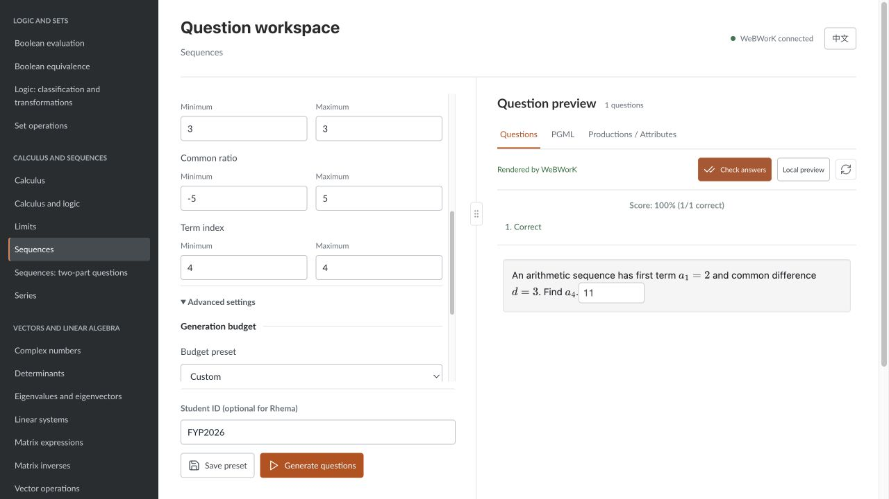

# Rhema FYP Demo 操作稿

核对日期：2026-10-31。代码基线：`main`，`5545aa182494797ce7d2859bacd15353a620d921`。
项目目录：`/Users/ray/Desktop/Project-RHM_latest 2`。

本版由旧 `Project-RHM/deliverables/fyp_demo_20261027` 更新而来。旧版保留不动；不要再按旧版“网页不能渲染和判分”的说明演示。

**开发者工具补充：** 项目还提供 Rhema VS Code 扩展。推荐将第 4 节的部分源码操作替换为 [VS Code + CLI 综合路线](VSCODE_CLI_DEMO.md)，总计约 10–12 分钟；不是在原路线之后再重复演示一遍。专用 [工作区](Rhema-Demo.code-workspace) 已指定本项目引擎路径，未更改全局 VS Code 设置。

## 1. 这次演示要证明什么

不要把 demo 做成逐个点击所有题型。用三条线讲清楚：

1. 教师不写代码，也能配置已有题型；有代码能力的教师仍可编辑 Rhema。
2. 题目结构、随机参数、预算和答案关系放在 specification 中，已有数学库可以复用成新题型。
3. 同一流程生成 PGML 和推导树，并由真实 WeBWorK renderer 展示、判分；相同输入可重现。

开场可以说：

> Our project extends an existing PGML generator into a specification-driven system. Stage 1 added question families. In Stage 2, we developed Rhema as a team, so teachers can describe generation rules and reuse mathematical libraries. The current web workspace supports both form-based configuration and source editing, followed by WeBWorK preview and answer checking.

说明分工时，区分继承的 Classic、共同开发的语言及各自负责的题型与库，不要说一个人从零完成了全部编译器。

## 2. 与旧材料相比更新了什么

| 旧版情况 | 当前演示 |
| --- | --- |
| 顶部选 Attribute Grammar、主要展示源码 | 左侧题库，中间 Configure / Rhema source，右侧预览，分隔线可拖动 |
| cost 只能改源码 | 已有题型的 Configure 提供预算、随机范围、规则价格/权重等实际暴露的选项 |
| 主要显示 PGML 和树 | Questions 显示 Docker WeBWorK 的题面；PGML 和树仍可切换 |
| 没有网页作答判分 | Check answers 返回总分与逐空反馈，输入变化后旧成绩失效 |
| 现场需另外找 WeBWorK 课程 | 本地 renderer 可直接演示，不需要向真实课程提交成绩 |
| 没有无代码流程 | 表单生成 Rhema、可保存 preset、导出 specification；源码模式保留 |

这里的 WeBWorK preview 不是完整课程平台，也没有把分数写入课程 gradebook。

## 3. 答辩前准备

### 3.1 启动顺序

如果页面已经在 5003 正常运行，直接使用，不要重复启动。需要重新启动时，从正确项目目录执行：

```sh
cd "/Users/ray/Desktop/Project-RHM_latest 2"
docker compose -p rhema-workspace-local up -d --wait webwork-renderer
```

如有引擎源码更新，再运行 `dune build`；运行目录是该项目的 `generator/`。然后回到项目根目录：

```sh
APP_PORT=5003 .venv/bin/python app.py
```

页面地址：<http://127.0.0.1:5003/>。右上角应显示 **WeBWorK connected**。
若端口已占用，先确认是不是本项目服务；不要把另一个旧项目的页面当作新版，也不要随意结束不明进程。

本次验证使用的是本机 Python / OCaml 引擎配合 Docker renderer。没有在本轮重新构建整个 app 容器镜像。

### 3.2 材料与复核

`demo_budget.rhm`、`demo_sequence_gap.rhm`、`demo_polynomial.rhm` 是网页用示例。它们也保存在本材料目录，方便新建语法时取用。
在 **My presets** 可以选已保存的用户文法；标准题库在 **Question library**。

重新核验：

```sh
.venv/bin/python deliverables/fyp_demo_20261031/verify_demo.py
```

核验只覆盖本套演示，不应称为重跑项目全部测试。脚本不修改业务源码、标准库或个人设置。结果写入 `output/verification.json`，失败时不会继续保留一个看似刚通过的旧报告。

开场前：English、Student ID `FYP2026`，收起无关高级设置。预先打开本操作稿和一份树形 HTML 备用文件。不要依赖旧临时克隆中的服务。

## 4. 推荐流程：约 9 分钟

### 4.1 0:00–0:30：项目定位

展示题库覆盖的领域。当前 30 个可运行标准文法文件不等于 30 个独立数学领域，一个文件也可能包含多个命名题型。

简述两阶段：Stage 1 扩展题型；Stage 2 把生成结构、约束和答案关系移入 Rhema，并让教师通过网页使用。

### 4.2 0:30–2:00：不写代码生成题目

选择 **Sequences → Configure**，设置：

| 参数 | 值 |
| --- | --- |
| Number of questions | 1 |
| First term Minimum / Maximum | 2 / 2 |
| Common difference Minimum / Maximum | 3 / 3 |
| Term index Minimum / Maximum | 4 / 4 |
| Advanced settings → Complexity budget | 1 |
| Student ID | FYP2026 |

其他设置保持默认，Generate questions。得到 `a₁=2, d=3, 求 a₄`，答案 `11`。

这里所有相关随机范围被固定，故意只出一道题；如果 count 很大，重复题不是 seed 出错，而是可变参数被关闭。

打开 **Generated Rhema**，只指出 `random`、`attribute cost` 和计算 `value` 的地方：

> The form does not use a separate mathematics generator. It transforms these settings into a Rhema specification, which is checked and executed by the same engine.

可顺手展示 Save preset，说明保存为新的用户文件，不覆盖标准库。Export specification 在 Output settings 中，时间够再展开，不需要现场演示每个选项。

**不要为显示生成后的配置而直接切到 Rhema source。** 原标准文件的源码可能仍是原默认值；表单刚生成的准确内容在 Generated Rhema 中。

### 4.3 2:00–2:40：真实作答与判分

在 WeBWorK 输入框填 `0`，点击 **Check answers**，显示 0%、Incorrect。
改成 `11`，再点击，显示 100%、Correct。

解释：PGML 给出题面和答案 evaluator；WeBWorK 用 evaluator 比较学生输入，不是 Python 只比较两个字符串。数学等价性、集合和向量等类型依赖其各自 evaluator。

这不等于形式化证明所有 specification 正确；题目自身的答案仍需生成逻辑、语义约束和独立测试共同核验。

实际截图：



### 4.4 2:40–4:30：预算怎样改变生成结构

在 **My presets** 选择 `demo_budget.rhm`，切到 **Rhema source**。Student ID `FYP2026`，Number of questions `2`。

先以 `attribute cost = 4 split` 生成；再改成 `attribute cost = 10 split`，Save 成功后再次 Generate。

| cost | 第一道题 | 第一题答案 | 第二题答案 |
| --- | --- | --- | --- |
| 4 | `3 + 9 + (4 + 3 + 8)` | 27 | 84 |
| 10 | `3 + 9 + (4 - (8 + 6)) * (9 - 8)` | 2 | 1 |

这组文件名、源码、数量、学号与版本已实际验证。改名或换模式后，不要把本表当作固定答案。

只解释一个规则：

```rhm
E -> E * E when cost >= 3 weight 2 {
  cost = -3
  value = $1.value * $3.value
  latex = infix($1, "\\cdot", $3)
}
```

- `E -> E * E`：表达式可以由两个子表达式组成，是递归结构，不是固定两个数。
- `when`：当前预算必须容纳这条规则。
- `cost = -3`：扣除本规则价格；`split` 再分配余下预算。
- `weight`：在可用规则中影响选择概率，不是出现次数。
- `$1`、`$3`：右侧第一、第三个符号；中间的 `*` 也占一个位置。
- `value` 用结构化计算得到答案，`latex` 处理显示与括号。

打开 **Productions / Attributes**。cost 10 的第一题根规则是加法，扣 1 后两子树分别分到 1 和 8；它们得到 12 和 -10，根节点综合为 2。

> Inherited attributes carry generation requirements down the tree. Synthesized attributes bring the answer and presentation back up.

这两张图是 Applied Production Tree 和 Attributed Derivation Tree，不是 Classic parser 的 DCST。只讲一条从父到子再回到父的路径，不必逐个展开所有节点。

说明边界：cost 是作者定义的结构/运算预算，不是树深，也不是已通过学生成绩校准的教学难度。固定形式的数列预算只选择可用形式，不能任意提高来“加长题目”。

### 4.5 4:30–6:00：新增一个题型，而不是新增 OCaml 分支

使用 `demo_sequence_gap.rhm`。它不是改原数列的数字，而是改变问法：由“给首项与公差求某项”变成“给两项求公差”。

演示完整流程时：Rhema source → New Grammar → 输入未占用文件名 → Create Draft → 填入该文件内容 → Check → Save → Generate。
本套示例已保存为 `demo_sequence_gap.rhm`，可直接选中演示。若要现场新建副本，可命名 `demo_sequence_gap_live.rhm`；新名字会改变 assignment seed，对新输出现场按公式求解，不能照搬下述固定答案。

使用原名、count 1、FYP2026 的实际结果：

```text
a_3 = 3, a_6 = 6
d = (6 - 3) / (6 - 3) = 1
```

在源码中只讲三组关系：

```rhm
let first_given = first + (first_index - 1) * difference
let second_given = first + (second_index - 1) * difference

value = (second_given - first_given) / (second_index - first_index)
require value = difference
```

先随机生成合法数列及两个不同位置，再算出给学生看的两项；答案又由两项回算。这样不需要随机猜两项后再碰运气判断是否构成合适的数列。

本次没有增加数学 builtin，也没有改 OCaml engine。这是已有语义能力范围内的 specification 扩展；若是新数学对象或全新计算，则仍可能需要底层库。

### 4.6 6:00–7:40：数学库复用与多答案

选择 `demo_polynomial.rhm`，Rhema source，Question **main**（若有下拉框）、count **1**，FYP2026。

实际题目：`P(x)=(x+6)²(x-5)`，要求展开并求 `P(-3)`。

正确输入：第一空 `x^3+7*x^2-24*x-180`，第二空 `-72`。
先第一空正确、第二空填 `0`，Check answers 得 **50%**；第二空改为 `-72`，再得 **100%**。

只讲以下片段：

```rhm
include "polynomial_core.rhm"
expanded = $1.poly
at_point = polynomial_evaluate($1.poly, point)
```

因式的生成树与乘法规则由库提供，同一个 Polynomial 值支持展开和取值。prompt 用两个 `{answer ...}` 插入各自的答案空。

PGML 中能看到 `Formula('x^3+7*x^2-24*x-180')` 与 `-72`。这里的 Formula comparator 判断代数等价，并不强制展开形式；若要严格考核特定书写形式，需要相应 context / evaluator。

该文件也有 `question value`，只问取值。本次该命名题型为 `(2x+3)(x+5)` 在 x=1 处取值，答案 30。**不要声称切换命名题型后一定保持相同多项式**，它对应不同 assignment identity。

有时间再展示这一切换；新保存 question block 后，若下拉框尚未出现，刷新页面并重新选择该文件，不要现场排查无关 UI。

### 4.7 7:40–8:40：可复现与个性化

使用预算或多项式示例，在相同文件、内容、配置、题型、count 和学号下重复 Generate。题面、答案保持不变；时间戳文件名不同是正常的。

改为 `FYP2027` 再生成。本套 CLI 演练的六组源码场景都观察到了不同输出，记录在 verification.json；这不是不同学号永不重复的数学保证。

不要用先前全部固定范围的数列开场题做“换学号必然换题”的演示。

### 4.8 8:40–9:00：结束

> The demo shows one pipeline serving two kinds of users: teachers can configure existing questions without coding, while advanced users can extend question specifications in Rhema. The engine reuses mathematical libraries, records its derivation, and produces WeBWorK-compatible questions with reproducible variants. New mathematical semantics and educational calibration remain areas for further work.

## 5. 可选加分项：整份作业

`demo_assignment.rhm` 组合数列、Boolean evaluation 与 eigenvalues，共 5 道题、6 个答案空。
目前不要在网页上承诺有完整的 set 配置器，这一项用 CLI 演示：

```sh
cd "/Users/ray/Desktop/Project-RHM_latest 2/generator"
./_build/install/default/bin/rhema ../deliverables/fyp_demo_20261031/demo_assignment.rhm \
  -I stdlib --run defense --assignment demo_assignment.rhm:main --student FYP2026 \
  -o ../deliverables/fyp_demo_20261031/output/assignment.pg
```

该确切调用的六个答案依次为 `-31`、`-95`、`1`、`1`、`0`、`{-4,0}`。实际题面见 `output/assignment.txt`。
`distinct` 约束重复、`balanced` 影响分配、`ordered` 按成本排序；不应把成本排序称为经教育实验验证的从易到难。

## 6. 已验证的范围

- 当前引擎对四份 `.rhm` 均通过 check；生成了两个预算、多项式 main / value、新数列与整份作业，并验证相同输入重放一致。
- 教师数列通过真实 form backend 生成，测试在临时目录进行，没有改个人 preset。
- 7 组输出共 15 个答案空，通过当前 Flask API 调用本地 Docker WeBWorK：正确提交 100%，刻意错误提交 0%；多项式一对一错得 50%。
- 预算表达式另用受限 Python AST 数值计算核对；数列公差根据实际显示的两项独立回算。其他库复用示例的具体数学答案也提供于题面/答案文件中，不能把 PG 自己的 grader 当作独立数学证明。
- 浏览器实际操作通过了 Configure → Generate → Render → Wrong/Correct checking，以及 New Grammar → Check → Save → Generate → Tree。
- 这些是本套 demo 的验证结果，不代表本轮又执行了仓库全部 unit/integration tests，也不是远程课程部署测试。

## 7. 备用方案和容易被追问的边界

| 情况 / 提问 | 应对 |
| --- | --- |
| Docker 不在线 | 先检查右上角连接；展示已有截图和备用 `.pg` / HTML tree，明确本次改为离线展示 |
| Local preview 能否判分 | 不能，它是明确标注的本地排版 fallback |
| 生成失败 | 恢复已验证的默认预算和规则，不要现场尝试很大 cost 或冲突的长度限制 |
| 新题是否完全零代码 | 现有数学类型和 builtin 足够时，只加 `.rhm`；新领域仍可能扩 OCaml 语义库 |
| 输出独立的 generator 程序吗 | 当前是引擎检查并执行 specification，输出 `.pg` 和树，不是一般地导出独立 OCaml generator 源码 |
| 为何保留 Classic | 保留 Stage 1 的固定生成路径；此次重心是 specification 驱动的 Rhema |
| 是否已有 AI 个性化出题 | 核心是受约束的文法生成和数学计算，不是 LLM 随机编题，也没有根据学习记录自适应调整难度 |
| 是否保证每题绝不重复 | 不保证；有确定性种子和部分 distinct 策略，候选空间、固定参数与规则会限制多样性 |
| 为什么不把 30 个文件全点一遍 | 演示要证明结构可控、语义可复用和使用流程完整，覆盖广度由题库与测试说明补充 |

答辩当天不要临时 pull 后直接演示。若更新了代码或规格，先重跑本材料的核验并排练，再决定使用哪个版本。

## 8. VS Code / CLI 的展示重点

VS Code 扩展是 specification 作者的编辑环境：高亮、snippets、Problems 诊断、Run Question 和 Compile to PG。扩展通过子进程调用同一个 Rhema CLI，不是独立 parser 或另一套答案逻辑。

按钮的 Run 默认出 5 题、无 student 参数；Compile 写 .pg。多个 question/set 时可选择，set 也可由扩展执行。预算 override、学生种子、数量和树导出则在集成终端演示。

完整的阶段解释是 source → tokens → source AST → checked spec → seed/budget-driven derivation → typed Question IR → PGML。CLI 不逐步打印所有内部结构；实际可展示 check/list/run、PG、属性文本和 HTML。不能把 --ast-out 的生成树说成源文件 AST。

扩展真实调用方式和 CLI 输出已核对；本次原生 VS Code 控制权限不可用，未声称已实际点击扩展按钮。操作步骤、确切答案与重放记录均在新增操作稿和 output/cli 下。
